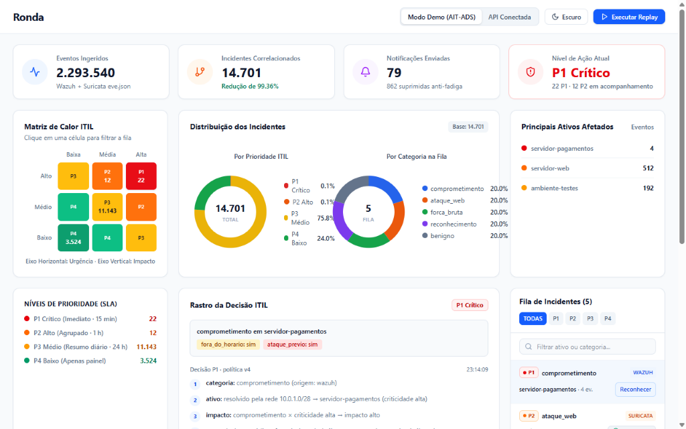
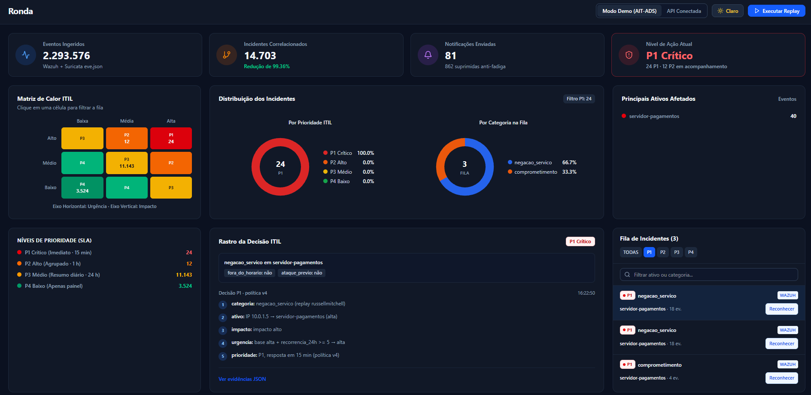

# Ronda

**Governança determinística e auditável para priorização de alertas em NOC/SOC.**

O **Ronda** transforma milhares de alertas brutos de ferramentas de segurança (**Wazuh**, **Suricata** ou detectores próprios) em poucos **incidentes priorizados nos níveis ITIL (P1 a P4)** — com rastro de decisão explicável em português, controle de SLA por criticidade de ativo e roteamento anti-fadiga para equipes enxutas.

> Evolução de engenharia aplicada a partir do TCC *"Aplicação de Inteligência Artificial na Governança de Infraestrutura"* (Engenharia de Telecomunicações, UFC, 2026).

---

## Painel operacional (Modos Claro e Escuro)



<details>
<summary>Ver também no Modo Escuro</summary>



</details>

---

## Por que o Ronda importa para operações de TI

Equipes de infraestrutura e segurança frequentemente desligam alertas por excesso de ruído. Em vez de usar "caixa-preta" para decidir o que é crítico, o Ronda separa **detecção** de **governança** ([ADR 0002](docs/adr/0002-governanca-independente-do-detector.md)):

- **Menos fadiga, mais foco no que é crítico:** correlação temporal agrupa rajadas de alertas em um único incidente, enquanto regras de silêncio por origem, janela de expediente e resumo diário evitam interrupções desnecessárias.
- **Decisão auditável (sem caixa-preta):** cada prioridade (`P1` a `P4`) grava o passo a passo exato — categoria, criticidade do ativo afetado, modificadores de contexto e versão da política — em tabela *append-only* ([ADR 0003](docs/adr/0003-decisao-gravada-apenas-na-subida-de-prioridade.md)).
- **Governança na mão do gestor:** inventário de ativos por rede CIDR, matriz Impacto × Urgência, prazos de SLA e simulação *what-if* sobre incidentes reais antes de publicar uma nova política YAML.
- **Isolamento multi-tenant desde o banco:** separação por organização com Row-Level Security (`FORCE RLS`) no PostgreSQL 16 e chaves compostas ([detalhes de armazenamento](docs/armazenamento.md)).

---

## Resultados comprovados (Benchmark AIT-ADS)

Avaliado sobre **~2,6 milhões de alertas** nos 8 cenários do conjunto público **AIT-ADS** (39,7 dias de operação simulada em [docs/avaliacao-fase2.md](docs/avaliacao-fase2.md)):

| Métrica | Política inicial (v3) | Política calibrada (v4) |
| --- | ---: | ---: |
| Incidentes correlacionados | 14.797 | **14.701** |
| Incidentes P1 / P2 | 153 / 257 | **22 / 12** |
| Notificações enviadas ao Telegram | 450 | **79** |
| Mensagens urgentes (P1/P2) | 402 (10/dia) | **31 (0,8/dia)** |
| Supressões anti-fadiga (silêncio por origem) | 0 | **862** |
| Ataques reais detectados (escalada + web) | 8 de 8 cenários | **8 de 8 cenários** |

**Resultado:** redução de **~13× nas notificações urgentes (P1/P2)** mantendo **100% de detecção** nos cenários avaliados.

---

## Como funciona na prática

1. **Ingestão desacoplada:** adaptadores para Wazuh, Suricata (`eve.json`) ou fontes customizadas normalizam alertas via API autenticada (`POST /v1/ingestao/*`) e fila **Redis Streams**.
2. **Correlação contextual:** eventos com mesma origem, categoria e ativo dentro da janela configurada formam um único incidente, calculando `recorrencia_24h`, `fora_do_horario` e `ataque_previo_no_ativo`.
3. **Motor ITIL determinístico:** resolve o ativo no inventário (nome, IP ou CIDR mais específico), cruza `categoria × criticidade` (Impacto), aplica modificadores de Urgência e define `P1–P4` + SLA.
4. **Rastro, painel e alerta:** a decisão é persistida com evidência JSONB, exibida no **Dashboard Next.js** (com Modo Demo, matriz ITIL clicável e filtro por prioridade) e enviada ao **Telegram** conforme a política anti-fadiga.

Veja [docs/architecture.md](docs/architecture.md) para a visão arquitetural e [docs/policies.md](docs/policies.md) + [policies/examples/demo.yaml](policies/examples/demo.yaml) para configurar políticas.

---

## Stack e decisões de engenharia

- **Backend & Motor:** Python 3.12+, FastAPI, Pydantic v2, domínio puro desacoplado de I/O
- **Dados & Segurança:** PostgreSQL 16 (SQLAlchemy 2, Alembic, `FORCE RLS` multi-tenant, triggers *append-only*), Redis 7 Streams
- **Frontend:** Next.js, TypeScript, Tailwind CSS (tema claro/escuro, Modo Demo sem backend, fila P1–P4 e rastro ITIL)
- **Qualidade & Infra:** Ruff, Pytest (209 testes unitários + 90 de integração com Testcontainers), GitHub Actions CI e Docker Compose

---

## Situação do roadmap

| Fase | Entregas | Estado |
| --- | --- | --- |
| 1. Núcleo | Esquema de evento, motor determinístico com rastro, política em YAML, testes, API | **concluída** |
| 2. Alertas | Adaptador Wazuh, ingestão Redis Streams, PostgreSQL + RLS, correlação, Telegram anti-fadiga | **concluída** |
| 3. Produto visível | Adaptador Suricata (`eve.json`), API `/v1/incidentes` e `/v1/metricas`, Dashboard Next.js, Docker Compose, amostras `samples/` | **concluída** |
| 4. IA local | Tradutor explicativo com LLM local (Ollama/`llama.cpp`) e detector XGBoost do TCC como fonte | **planejada** |
| 5. Maturidade | Reteste no CSE-CIC-IDS2018, monitoramento de drift, NOC híbrido, observabilidade, Terraform AWS | **planejada** |

---

## Executando em 2 minutos com Docker

Copie `.env.example` para `.env`, ajuste as senhas e suba a stack completa (PostgreSQL, Redis, migrations, API `:8000`, Worker e Dashboard `:3000`):

```sh
cp .env.example .env
docker compose -f deploy/docker/docker-compose.yml --env-file .env up -d --build
```

Acesse:
- **Dashboard Web (inclui Modo Demo sem backend):** <http://127.0.0.1:3000>
- **Documentação interativa da API (Swagger):** <http://127.0.0.1:8000/docs>

<details>
<summary>Execução local em desenvolvimento (Python + Node.js)</summary>

Requer [uv](https://docs.astral.sh/uv/), Python 3.12+ e Node.js 22+.

```sh
uv sync
uv run pytest -m "not integracao" -q          # testes unitários
uv run uvicorn ronda.api.main:app --reload    # API em http://127.0.0.1:8000/docs
```

Dashboard em desenvolvimento:

```sh
cd dashboard && npm install && npm run dev    # http://127.0.0.1:3000
```

Para testes completos com PostgreSQL/RLS (`make up` via `deploy/compose/dev.yml`), execute `uv run pytest -m integracao`.

</details>

---

## Estrutura do repositório

| Pasta | Conteúdo |
| --- | --- |
| `src/ronda/domain/` | Núcleo puro, sem I/O: evento, incidente, notificação, taxonomia, escalas ITIL |
| `src/ronda/governance/` | Política YAML, motor determinístico, rastro auditável e simulação |
| `src/ronda/adapters/` | Adaptadores plugáveis (`wazuh/`, `suricata/` nativo `eve.json`, placeholders `detector_tcc/` e `webhook/`) |
| `src/ronda/correlation/` | Agrupamento temporal por janela e reavaliação monotônica |
| `src/ronda/storage/` | SQLAlchemy 2, Alembic (4 migrations), RLS multi-tenant e repositórios de métricas |
| `src/ronda/notifier/` | Roteamento anti-fadiga, resumo diário e canal Telegram |
| `src/ronda/api/` | FastAPI (`/v1/ingestao`, `/v1/incidentes`, `/v1/metricas`, `/v1/politicas`, `/v1/eventos`) |
| `dashboard/` | Interface web em Next.js (fila P1–P4, rastro ITIL, simulador de política e Modo Demo) |
| `deploy/docker/` | Dockerfiles e Compose de stack completa |
| `samples/` | Recortes reais redistribuíveis do AIT-ADS (CC BY 4.0) para demo e replay |
| `data/` | Datasets **fora do git**; só manifesto e README versionados ([data/README.md](data/README.md)) |
| `docs/adr/` | Registros de decisão arquitetural (`0001` a `0003`) |

## Licença

[MIT](LICENSE). Amostras do AIT-ADS em `samples/` seguem a licença CC BY 4.0 dos autores originais ([samples/README.md](samples/README.md)).
